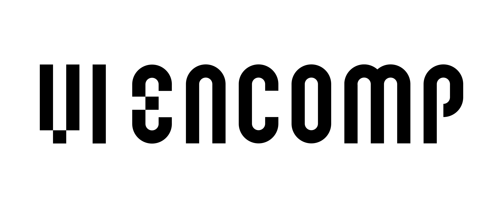
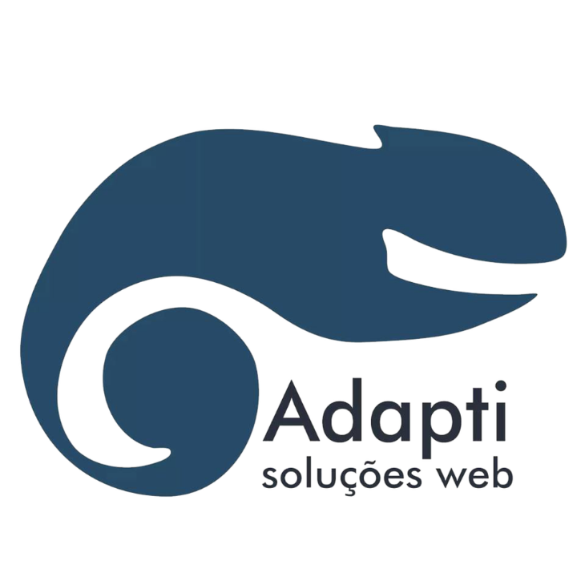

<div align="center">



# Minicurso de Git e GitHub

Material usado no minicurso da **ENCOMP 2026**, desde os conceitos básicos de versionamento até a publicação de um repositório no GitHub.

[Conteúdo](#conteúdo-do-minicurso) · [Prática](#prática-guiada) · [Comandos](#comandos-que-vamos-usar) · [Material extra](#material-extra)

</div>

---

##  Sobre o minicurso

Este repositório reúne os slides, os arquivos usados durante a aula e alguns materiais para continuar estudando depois do minicurso.

A ideia é entender o que o Git registra, como um repositório funciona e qual é o papel do GitHub nesse processo. Depois da explicação, vamos criar um repositório, fazer commits e enviar o projeto para uma conta do GitHub.

Os comandos da prática foram preparados para o terminal **Bash**, no **Fedora** ou no **Linux Mint**. Git e VS Code já devem estar instalados.

##  O que vamos aprender

- O que é controle de versão e por que ele é usado em projetos de software.
- A diferença entre Git e GitHub.
- O que são repositórios locais e remotos.
- Como o Git acompanha as alterações feitas nos arquivos.
- Como usar `git init`, `git status`, `git add` e `git commit`.
- O que são branches e como um merge integra alterações.
- Como criar um repositório no GitHub e enviar os commits com `git push`.
- O que significam clone, pull request, issue, fork e GitHub Actions.

##  Conteúdo do minicurso

| Etapa | O que vamos fazer |
| :-- | :-- |
| **Fundamentos** | Conversar sobre versionamento, Git, GitHub, repositórios, commits, branches e merge. |
| **Demonstração** | Criar um repositório e acompanhar o caminho de uma alteração até o commit. |
| **Kahoot** | Revisar os conceitos com perguntas rápidas. |
| **Prática guiada** | Criar um README, publicar um repositório no GitHub e fazer uma segunda atualização. |
| **Encerramento** | Rever os erros mais comuns e indicar caminhos para continuar praticando. |

##  Prática guiada

Durante a prática, cada pessoa vai criar um pequeno projeto com um `README.md`. A conta será conectada pelo VS Code e os comandos serão executados no terminal Bash.

O caminho será este:

1. Abrir uma pasta no VS Code.
2. Criar ou copiar o `README.md` usado na aula.
3. Iniciar o repositório Git local.
4. Conferir os arquivos modificados.
5. Preparar e registrar o primeiro commit.
6. Criar um repositório vazio no GitHub.
7. Conectar o repositório local ao remoto.
8. Entrar no GitHub pelo VS Code quando a autenticação for solicitada.
9. Enviar a branch `main`.
10. Alterar o README, criar outro commit e fazer um novo `push`.

O roteiro completo está em [pratica/passo-a-passo.md](pratica/passo-a-passo.md). Se algum comando não funcionar como esperado, consulte [pratica/erros-comuns.md](pratica/erros-comuns.md).

##  Comandos que vamos usar

| Comando | O que ele faz |
| :-- | :-- |
| `git --version` | Mostra a versão do Git instalada. |
| `git config --global user.name "Seu Nome"` | Define o nome usado nos commits. |
| `git config --global user.email "seu-email@exemplo.com"` | Define o e-mail usado nos commits. |
| `git init -b main` | Inicia um repositório e cria a branch principal com o nome `main`. |
| `git status` | Mostra a situação atual dos arquivos. |
| `git add README.md` | Coloca o README na área de preparação. |
| `git commit -m "Adiciona README inicial"` | Registra uma versão local do projeto. |
| `git log --oneline` | Mostra o histórico resumido, com um commit por linha. |
| `git branch` | Lista as branches locais. |
| `git switch -c nova-branch` | Cria uma branch e muda para ela. |
| `git switch main` | Volta para a branch principal. |
| `git merge nova-branch` | Integra a branch indicada à branch atual. |
| `git remote add origin URL` | Liga o repositório local a um repositório remoto. |
| `git remote -v` | Mostra os endereços remotos configurados. |
| `git push -u origin main` | Envia a `main` e registra o destino dos próximos pushes. |
| `git clone URL` | Baixa uma cópia de um repositório remoto. |
| `git pull` | Busca alterações do remoto e tenta integrá-las à branch atual. |

As opções que aparecem nos comandos também têm uma função:

- `-b` define o nome da branch criada por `git init`.
- `--global` aplica a configuração ao usuário do computador.
- `-m` permite escrever a mensagem do commit no próprio comando.
- `--oneline` resume cada commit em uma linha.
- `-c` significa *create*: cria a nova branch antes de mudar para ela.
- `-u` registra a relação entre a branch local e a branch remota.

```text
editar arquivos → git status → git add → git commit → git push
```

O `commit` registra a alteração no repositório local. O `push` envia os commits para o repositório remoto no GitHub.

##  Arquivos deste repositório

| Material | Link |
| :-- | :-- |
| Passo a passo da prática | [pratica/passo-a-passo.md](pratica/passo-a-passo.md) |
| Soluções para erros comuns | [pratica/erros-comuns.md](pratica/erros-comuns.md) |
| Exemplo de README de perfil | [perfil/README.md](perfil/README.md) |
| Como personalizar o perfil | [perfil/como-personalizar.md](perfil/como-personalizar.md) |
| Desafios para depois do minicurso | [desafios/depois-do-minicurso.md](desafios/depois-do-minicurso.md) |
| Sugestões de projetos simples | [projetos/ideias-para-praticar.md](projetos/ideias-para-praticar.md) |
| Links e referências | [referencias/materiais-de-estudo.md](referencias/materiais-de-estudo.md) |
| Diagrama sobre Git e GitHub | [Git e Github.excalidraw](Git%20e%20Github.excalidraw) |
| Diagrama sobre branches e merge | [Merge e Branches.excalidraw](Merge%20e%20Branches.excalidraw) |

Os slides apresentados no minicurso serão disponibilizados na pasta [`slides`](slides/).

##  Material extra

- [Documentação oficial do Git](https://git-scm.com/doc)
- [Livro Pro Git em português](https://git-scm.com/book/pt-br/v2)
- [Documentação do GitHub em português](https://docs.github.com/pt)
- [Sintaxe básica de Markdown](https://www.markdownguide.org/basic-syntax/)
- [Learn Git Branching](https://learngitbranching.js.org/?locale=pt_BR)

A lista comentada de referências, vídeos e ferramentas está em [referencias/materiais-de-estudo.md](referencias/materiais-de-estudo.md).

##  Organização

<table>
  <tr>
    <td width="150" align="center">
      <a href="https://www.adapti.info/">
        
      </a>
    </td>
    <td>
      <strong>Minicurso:</strong> Git e GitHub — ENCOMP 2026<br>
      <strong>Responsável:</strong> <a href="https://github.com/eduardocicutti">Eduardo Cicutti</a><br><br>
      A <a href="https://www.adapti.info/">Adapti Soluções Web</a> também faz parte da minha experiência com desenvolvimento e trabalho em projetos. É uma empresa júnior de Computação da UFES, em São Mateus, que desenvolve sites e sistemas web.
    </td>
  </tr>
</table>

Os ícones usados neste README são do projeto [Tabler Icons](https://tabler.io/icons), disponibilizado sob licença MIT.
